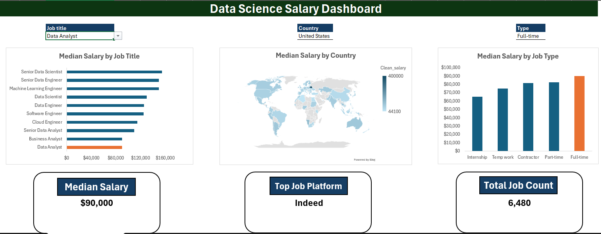

# Data Science Salary Dashboard

An interactive Excel dashboard analyzing median salaries, job volumes, and top hiring platforms across data roles, countries, and employment types. Using three dropdown selectors, users can filter the dataset and compare market rates dynamically.

## How It Works

* **Dynamic Controls:** The three dropdowns (`title`, `country`, `type`) use Named Ranges and Data Validation backed by `UNIQUE`, `SORT`, and `FILTER` arrays to clean messy schedule strings and update all metrics automatically.
* **Backend Engine:** Hidden helper tabs (`Jobs`, `Country`, `Type`, `Platform`) process multi-criteria aggregations using `COUNTIFS`, `XLOOKUP`, `ISNUMBER(SEARCH)`, and conditional `MEDIAN(IF)` formulas wrapped in `IFERROR`.
* **Chart Highlighting:** Stacked bar and column charts separate active selections from the rest using `NA()`, automatically highlighting the chosen role and job type without manual formatting.
* **User Protection:** Formula cells are locked, helper sheets are hidden, and the workbook structure is protected—leaving only the three dropdown inputs editable.

## Sample View (Data Analyst | United States | Full-time)

* **Median Salary:** $90,000
* **Top Platform:** Indeed
* **Job Count:** 6,480
